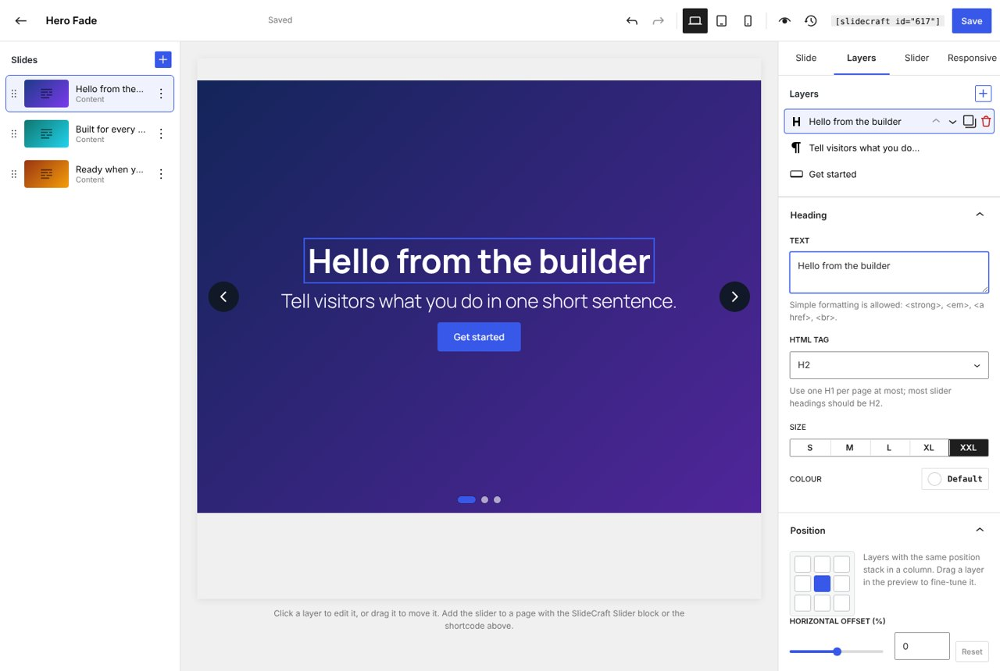
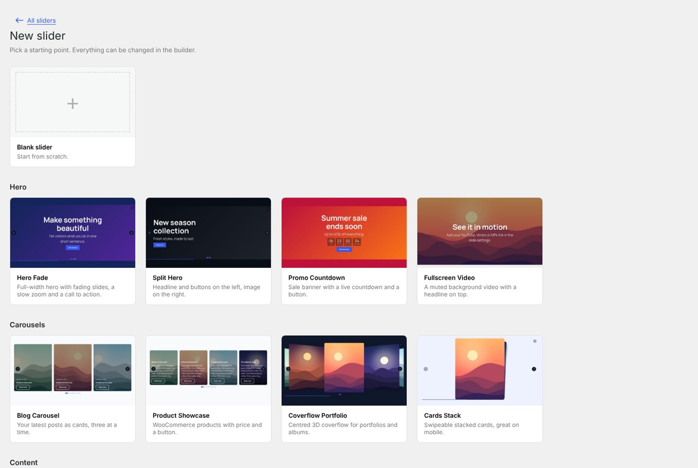
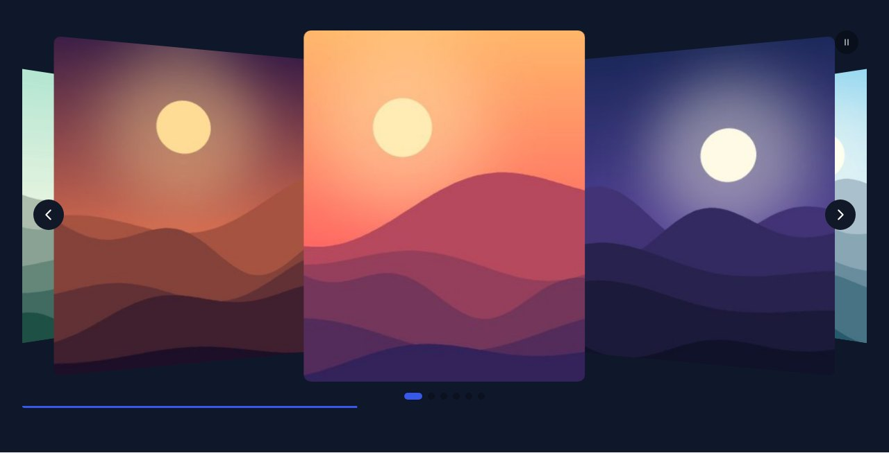
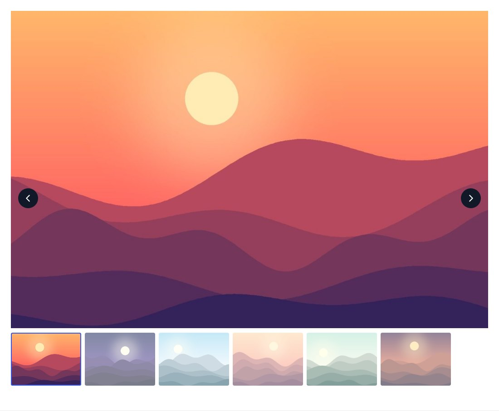
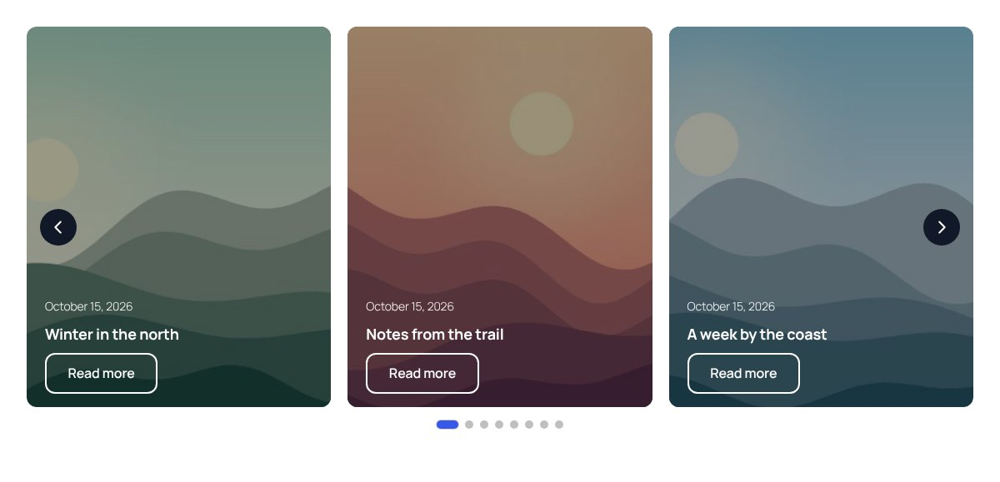
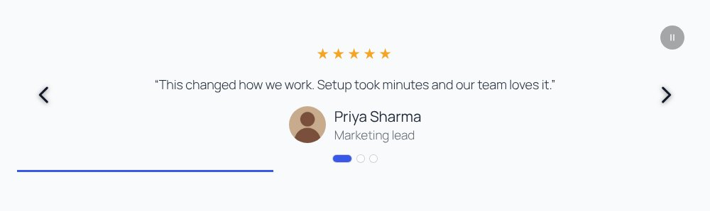
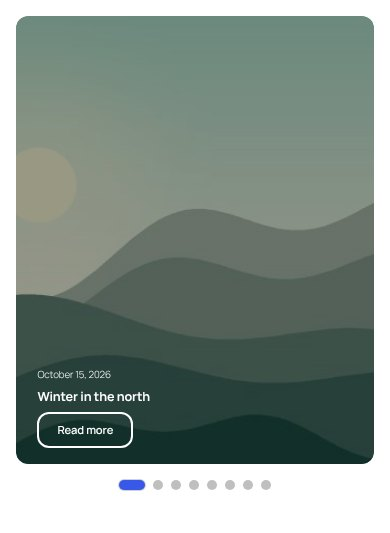

# SlideCraft – Responsive Slider & Carousel

[](https://wordpress.org/plugins/wp-smart-flexslider/)
[](https://github.com/rajanvijayan/wp-smart-flexslider/actions/workflows/ci.yml)
[](https://www.gnu.org/licenses/gpl-2.0.html)

Fast, accessible sliders and carousels for WordPress: hero sliders, post and product carousels, galleries, testimonials and logo tickers. Each slider is built once and placed anywhere with a block, a shortcode or a PHP function. SlideCraft is the 3.0 rewrite of **WP Smart Flexslider**; the plugin slug is still `wp-smart-flexslider`, and your existing sliders move over automatically.

**[WordPress.org listing](https://wordpress.org/plugins/wp-smart-flexslider/)**

> **Status:** 3.0 is in development. The version on WordPress.org is still 2.5 until 3.0.0 is released.


## Features

**Slider types and effects**
- Four layouts: slider, carousel (several slides per view, with rows, centred mode and free scrolling), gallery with thumbnails, and continuous ticker.
- Seven transitions: slide, fade, coverflow, cube, flip, cards and creative presets (zoom-out, push, rotate, stack).
- Horizontal or vertical, loop, random order, start slide, autoplay with a progress bar, keyboard, mousewheel and touch.

**Slides and layers**
- Image, video (YouTube, Vimeo or MP4), content, testimonial, logo and dynamic posts slides.
- Image, colour, gradient or video backgrounds, a focal point, Ken Burns zoom and a colour overlay.
- Heading, text, button, image and countdown layers on a nine-point grid, with offsets, per-device visibility and 9 entrance animations.
- **Dynamic slides** from posts, pages, custom post types or WooCommerce products, filtered by taxonomy, featured or sticky items, with title, excerpt, date, author, price, rating and button.

**Design**
- 12 starter templates: Hero Fade, Split Hero, Promo Countdown, Fullscreen Video, Blog Carousel, Product Showcase, Coverflow Portfolio, Cards Stack, Testimonials, Logo Ticker, News Ticker and Gallery + Thumbnails.
- Height by aspect ratio, fixed pixels, viewport height or the first image.
- Six arrow styles (inside, outside or on hover), bullets, dynamic bullets, fraction, progress bar or thumbnails.
- Accent, text and arrow colours, corner radius, shadow, fonts and caption styles.
- Separate tablet and mobile settings for slides per view, gap, height, text scale and arrows.

**Fast and accessible**
- About 32 KB of JavaScript (gzipped). Effects and extras load only on pages that use them, and nothing loads on pages without a slider.
- Space is reserved before images load, so there's no layout shift. The first slide is marked as the LCP image and the rest lazy-load with `srcset`.
- Sliders are swipeable before the script starts and work without JavaScript.
- ARIA carousel markup, a pause button whenever autoplay is on (WCAG 2.2.2), pause on focus and hover, keyboard support and `prefers-reduced-motion`.
- YouTube (no-cookie) and Vimeo (do not track) players load only when their slide is shown.

**Visual builder**
- Slider library with search, duplicate, export and import.
- Live preview that uses the real front end: click a layer to edit it, drag it to move it, and switch between desktop, tablet and mobile.
- Drag-and-drop slide list, layer list, and inspector tabs for the slide, its layers, the slider and responsive settings.
- Autosave, undo/redo and saved versions you can restore.

## Screenshots





| Coverflow portfolio | Gallery with thumbnails |
|---|---|
|  |  |
| **Blog carousel (dynamic posts)** | **Promo with countdown** |
|  |  |
| **Split hero** | **Cards stack** |
|  |  |
| **Testimonials** | **Logo ticker** |
|  |  |

**On mobile**

<p>

&nbsp;

</p>

## Usage

**Block:** add the **SlideCraft Slider** block, choose a slider, and optionally override autoplay or height. Wide and full alignment are supported.

**Shortcode:**

```text
[slidecraft id="12"]
[slidecraft id="12" align="full" autoplay="off" height="480" class="my-hero"]
```

**PHP:**

```php
<?php
// Echo a slider.
slidecraft_slider( 12 );

// Get the HTML instead, with overrides.
$html = slidecraft_slider( 12, array( 'autoplay' => true, 'height_px' => 420 ), false );
```

### Hooks

| Hook | Type | Use |
|---|---|---|
| `slidecraft_templates` | filter | Add, change or remove starter templates. |
| `slidecraft_slider_html` | filter | Change a slider's rendered HTML. |
| `slidecraft_base_capability` | filter | Capability needed to manage sliders (default `publish_posts`). |

## Upgrading from WP Smart Flexslider

- On update, every 1.x and 2.x slider is copied into SlideCraft with its images, titles, descriptions, links, arrows, pager, interval and pause-on-hover settings.
- `[display_flexslider id="…"]` and `[display_flexslider]` keep working and show the migrated slider, so no posts need editing.
- The old slider posts are never changed or deleted. Uninstalling SlideCraft removes only SlideCraft's own data.

## Requirements

| | |
|---|---|
| WordPress | 6.4 or later |
| PHP | 7.4 or later, including 8.4 |

## Development

```bash
composer install          # PHP tools
npm ci && npm run build   # admin app, block and front-end runtime into build/
npm start                 # rebuild on change

composer lint             # PHPCS (WordPress Coding Standards, PHP 7.4+ compatibility)
npm run lint:js           # ESLint
npm run lint:css          # Stylelint
vendor/bin/phpunit        # needs WP_TESTS_DIR; see bin/install-wp-tests.sh
```

`vendor/` and `build/` are not committed; the release workflow builds them. Releases are deployed to WordPress.org by GitHub Actions when a version tag is pushed. See [RELEASING.md](RELEASING.md).

## License

GPLv2 or later. SlideCraft bundles [Swiper](https://swiperjs.com/) (MIT).
